# Use cards with your AI

With an AI agent, such as Claude Code, you don't need to know which app you want or how a card works. Describe what you need in your own words. Your agent finds a card that fits, sets it up on your machine, checks that it works, and looks after it afterwards. When no card fits, it builds one with you, and you can share it back so the next person's agent finds it.



## What you need

- **An AI agent that runs commands on your machine.** Claude Code is what we test with. Other agents that read the open Agent Skills format can use the same skill.
- **Edgible on that machine:** the `edgible` CLI, logged in, with the machine added as a serving device. [Start here](https://guides.edgible.com/guides/start-here/index.html) if you haven't yet.
- **Docker**, for most cards. A native card, such as [ollama-mac](ollama-mac), runs without it.

## Install the skill

The skill is what teaches your agent about cards. For Claude Code:

```bash
git clone https://github.com/edgible-org/card-kit.git ~/.card-kit
mkdir -p ~/.claude/skills
ln -s ~/.card-kit/skills/edgible-cards ~/.claude/skills/edgible-cards
```

`git -C ~/.card-kit pull` keeps it up to date. For another agent, put the `edgible-cards` folder where that agent reads skills. To check it's there, ask: "What can you do with Edgible cards?"

## Ask in your own words

No special phrasing. Talk to it the way you'd talk to a friend who knows self-hosting:

- "Pocket is shutting down. I want to keep my saved articles and still read them on my phone." It offers two or three bookmark apps, recommends one, and says how the phone app signs in.
- "We pay $14 a month for website analytics. Could we run our own?" It points to the umami card, and is honest about whether the saving is worth the upkeep.
- "Get Uptime Kuma running so I hear when my site goes down." It uses the tested card and puts its choices to you before starting anything.
- "I want my Ollama models on my Mac's GPU, usable from anywhere." It sets up ollama-mac, behind an API key.
- "What's running, and is it all healthy?" A short table: each card, its hostnames, and whether each is up.
- "Gitea won't load on my phone today. What's wrong?" It works from the app outwards, and tells you what it found.
- "Back up Vaultwarden before I upgrade it." It backs up, upgrades, and checks it still works.

More, with what a good answer does, in [What to ask](https://github.com/edgible-org/card-kit/blob/main/skills/edgible-cards/EXAMPLES.md).

## When no card fits

Your agent doesn't stop at "there's no card for that":

1. It shortlists apps for your need from awesome-selfhosted, maintained and with a container image, and you pick one.
2. It writes a new card for it, in the same shape as every other card.
3. It tests the card end to end on your machine, with the same test the nightly regression runs, and shows you the result.
4. With your yes, it opens a pull request to [edgible-org/cards](https://github.com/edgible-org/cards), with the test result in it. Once it's reviewed and merged, the regression keeps testing it, and the next person's agent finds it.

If it can't make a card pass, it offers to open an issue instead, with what it tried. A fix to an existing card goes the same way.

## What it always asks you first

- Publishing an admin or personal page open to anyone.
- Installing software on the machine itself (a native card), or giving a container control of Docker.
- Stopping, changing or deleting anything it didn't set up, deleting data, upgrades, and moves. It backs up first.
- Anything that leaves your machine, such as a pull request or an issue.

It never shows your passwords in the chat. They stay in the card's `card.env` on your machine, and it tells you which line holds the one you need.

## Without a terminal

In Claude's desktop or web app, the skill runs in a sandbox that can't reach your machine. It still helps you choose, and then gives you each command to run yourself, one step at a time, and reads what you paste back.
